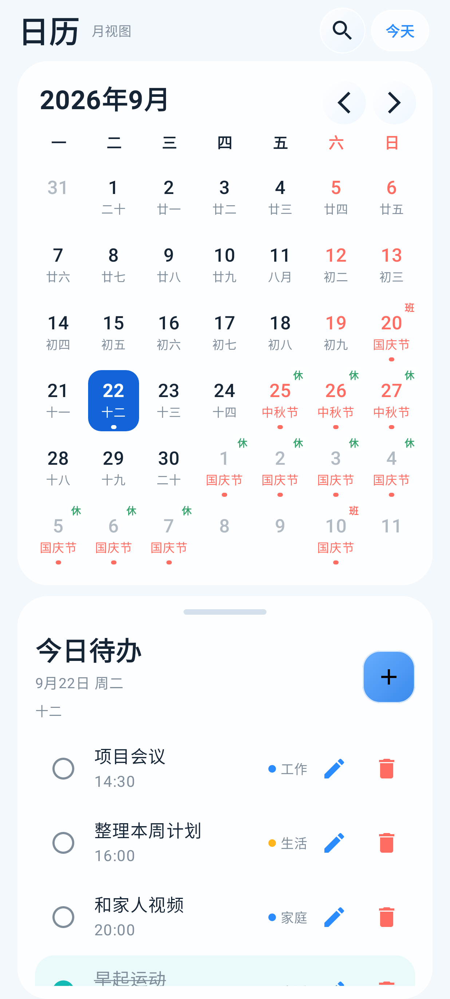

# 流光日历

流光日历是一款面向 Android 手机的中文日历与待办应用，使用 Kotlin、Jetpack Compose 和 Material 3 构建。应用将月历、农历、节假日和当天待办集中在一个界面中，并采用半透明的液态玻璃风格控件。

> 当前正式版本：**v1.0.2** · 提供正式签名 APK 和 Google Play AAB



## 功能概览

### 日历

- 周一至周日的月视图，支持左右滑动和箭头切换月份。
- 点击日期只切换高亮，不会意外跳离月视图。
- “今天”按钮可快速回到当天。
- 月视图旁提供月份入口，支持切换到年度 12 个月视图，再进入指定月份。
- 显示公历、农历、节日名称、法定休息日和调休上班日标记。
- 优先读取在线节假日数据，并缓存到本地；网络不可用时使用内置节日和年度兜底数据。
- 当前已内置 2026 年节假日与调休安排，其他年份可先显示固定节日，在线数据获取后自动更新。

### 待办事项

- 当天区域显示所选日期的全部待办和提醒，并将已完成事项放到列表底部。
- 支持添加、编辑、完成、取消完成、删除和延期待办。
- 支持一次性、每天、工作日、每周和自定义星期重复。
- 支持工作、生活、家庭等分类颜色。
- 日期和时间支持滚轮选择、手动输入和弹出式选择器。
- 支持关键词搜索，可查找不同日期和已完成状态的待办。
- 不再每天生成预设待办，只显示用户真实保存的内容。

### 提醒

- 设置时间前 10 分钟提醒一次，到达设置时间时再次提醒。
- 通知中提供“已完成”和“延后 10 分钟”操作。
- 支持重复待办在下一次发生时继续提醒。
- 支持开机、时间变化、时区变化和应用更新后恢复已保存提醒。
- Android 13 及以上需要允许通知权限；Android 12 及以上如需精确时间提醒，需要允许精确闹钟权限。

### 界面与图标

- 搜索、今天、添加、月份切换和表单选项使用液态玻璃风格控件。
- 使用圆形蓝色日历图标，并根据当天日期切换桌面图标数字。
- 针对窄屏和大屏 Android 手机提供响应式布局。

## 数据与隐私

- 待办数据保存在设备本地 SharedPreferences 中，不需要账号登录。
- 应用不会把待办内容上传到服务器。
- 节假日数据联网获取时仅请求公开的年度日历数据，并在本地缓存。
- 卸载应用会清除应用本地保存的待办和提醒数据。

隐私政策页面：[`docs/privacy-policy.html`](docs/privacy-policy.html)。上架 Play Console 时，建议将该页面部署到 GitHub Pages 后填写公开 URL。

## Google Play 上架资料

- 商店文案、数据安全填表建议和素材清单：[`docs/google-play-listing.md`](docs/google-play-listing.md)
- 上架步骤与待完成事项：[`docs/google-play-checklist.md`](docs/google-play-checklist.md)
- 正式签名 AAB：`outputs/liuguang-calendar-v1.0.2-release.aab`
- 正式签名 APK：`outputs/liuguang-calendar-v1.0.2-release.apk`

当前项目已完成本地发布前准备，但 Google Play Console 的账号验证、注册费、法律协议和最终提交必须由账号持有人完成。首次发布前请确认永久包名 `com.example.liuguangcalendar`。

## 技术栈

- Kotlin
- Jetpack Compose
- Material 3
- Android SDK 36，最低支持 Android 8.0（API 26）
- Java/Kotlin JVM 17
- Robolectric、JUnit 和 Compose UI 测试

## 构建与运行

1. 使用 Android Studio 打开项目根目录。
2. 等待 Gradle 同步完成。
3. 连接 Android 手机或启动模拟器。
4. 运行 `app` 配置。

开发构建 APK：

```text
./gradlew assembleDebug
```

### 构建正式签名版

正式版使用本地签名密钥。签名文件和密码不应提交到 GitHub。项目根目录提供了配置模板：
`keystore.properties.example`。

复制为 `keystore.properties` 后填写自己的签名信息：

```text
storeFile=签名文件路径
storePassword=签名库密码
keyAlias=签名别名
keyPassword=签名密码
```

构建可直接安装的正式 APK：

```text
./gradlew assembleRelease
```

构建提交 Google Play 的正式 App Bundle：

```text
./gradlew bundleRelease
```

生成的文件位于：

```text
app/build/outputs/apk/release/app-release.apk
app/build/outputs/bundle/release/app-release.aab
```

正式版使用独立签名。如果手机中安装的是早期测试构建，首次安装正式版时可能需要先卸载旧版本；正式版后续更新必须继续使用同一个签名密钥。

运行单元测试：

```text
./gradlew testDebugUnitTest
```

## 测试覆盖

当前测试覆盖：

- 待办本地保存与恢复
- 删除预设数据后的空存储行为
- 重复规则和分类数据持久化
- 日期、时间和滚轮交互
- 月份滑动、年度视图和今天按钮
- 关键词搜索与搜索结果操作
- 农历文本和节假日兜底数据
- 提醒发生日期、完成状态和通知操作

## 最新构建

当前版本：**1.0.2（versionCode 12）**

正式签名 APK：[`liuguang-calendar-v1.0.2-release.apk`](https://github.com/lxlatsdkd/liuguang-calendar/releases/download/v1.0.2/liuguang-calendar-v1.0.2-release.apk)

Google Play 上传包：[`liuguang-calendar-v1.0.2-release.aab`](https://github.com/lxlatsdkd/liuguang-calendar/releases/download/v1.0.2/liuguang-calendar-v1.0.2-release.aab)

### 1.0.2 更新内容

- 修复跨天后待办列表恢复为预设内容的问题。
- 删除每日预设待办，只保留真实保存的待办。
- 增加本地待办持久化，切换日期和重启应用后数据仍然保留。
- 完成、编辑、删除和通知操作后同步保存数据。
- 增加开机、时间变化、时区变化和应用更新后的提醒恢复。
- 修复 Robolectric 测试缓存目录问题，确保测试环境可重复运行。
- 增加正式签名 Release 配置。
- 升级到 Android API 36，生成 APK 和 AAB 两种正式产物。

## 项目结构

```text
app/src/main/java/com/example/liuguangcalendar/
  MainActivity.kt             主界面、月历、待办表单和搜索
  TaskRepository.kt            待办本地持久化
  ReminderScheduler.kt         闹钟、通知、完成和延期操作
  TaskRestoreReceiver.kt       开机及系统时间变化后的提醒恢复
  HolidayRepository.kt         节假日联网、缓存和内置兜底
```

## 说明

这是一个个人使用和持续迭代中的 Android 项目。当前公开下载内容均为 v1.0.2 正式签名构建：APK 适合直接安装，AAB 用于 Google Play 上传。正式上架仍需要准备隐私政策、商店截图、内容分级和数据安全表单。
