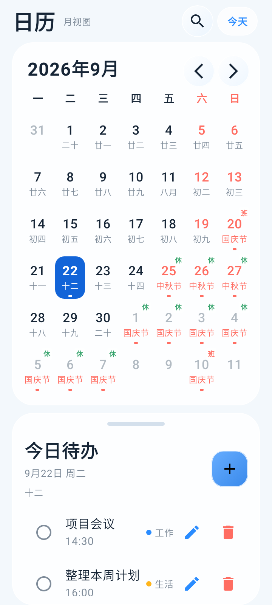
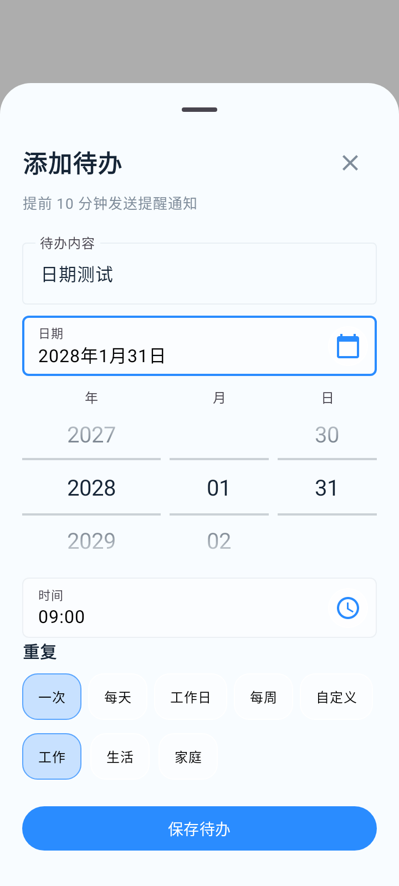
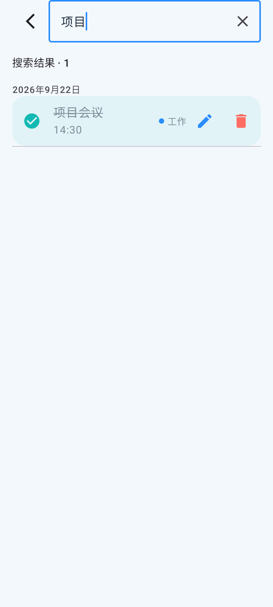

# 流光日历

一个Android 日历原型，使用 Kotlin + Jetpack Compose。界面简单大方，日历+待办组合，让你的工作生活一目了然。

## 当前已实现

- 周一到周日的月视图
- 公历日期、农历示意文本、节假日标签
- 月份前后切换和月份选择
- 当天待办列表
- 待办完成/取消完成
- 点击任务分类区域延期到下一天
- 添加待办底部弹层
- 液态玻璃风格的半透明面板
- 真实待办本地持久化，删除每日预设待办
- 切换日期、重启 App 后保留待办数据
- 开机、时间变化和时区变化后自动恢复提醒
- 提前 10 分钟和到点各提醒一次

## 截图

| 主界面 | 添加待办 | 搜索 |
| --- | --- | --- |
|  |  |  |

## 运行

使用 Android Studio 打开当前目录，等待 Gradle 同步后运行 `app`。

## APK

最新调试版 APK：[`liuguang-calendar-v18-debug.apk`](artifacts/liuguang-calendar-v18-debug.apk)

v18 主要更新：修复跨天后待办恢复为预设数据的问题，改为只显示真实保存的待办，并完善本地持久化和提醒恢复逻辑。
